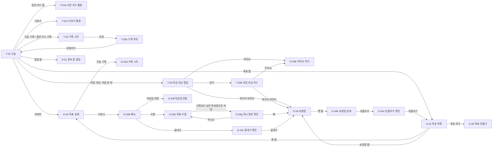
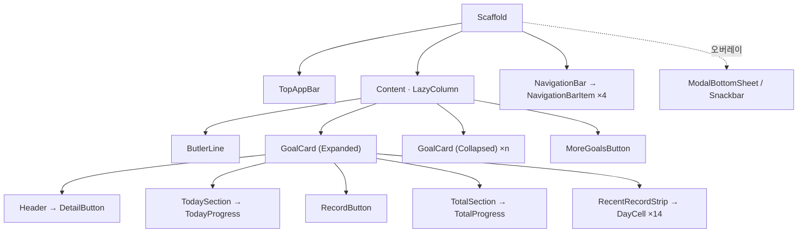

# 모바일 집사 디자인

> 실제 화면에 나올 디자인의 **정본**입니다. 초안 문서와 내용이 다르면 이 문서가 우선합니다.
>
> 기준일: 2026-10-28 · 정리: hss900606
>
> 합친 문서: [화면설계서 v0.2](draft/UI.md), [2차 시안 설명서](draft/hss900606_draft_261024.md) (PR #33), 논의 이슈 [#35](https://github.com/myaring/mobile-butler/issues/35) · [#36](https://github.com/myaring/mobile-butler/issues/36) · [#37](https://github.com/myaring/mobile-butler/issues/37) · [#38](https://github.com/myaring/mobile-butler/issues/38) · [#39](https://github.com/myaring/mobile-butler/issues/39) · [#40](https://github.com/myaring/mobile-butler/issues/40) · [#41](https://github.com/myaring/mobile-butler/issues/41)

> **Figma**: [Mobile-Butler · 2차 시안 · Android](https://www.figma.com/design/lTpDZI5Qgc55VRIsMxjmmn/Mobile-Butler?node-id=19-281)

## 문서 안내

| 항목 | 내용 |
| --- | --- |
| 읽는 대상 | 개발, 디자인, 기획 참여자 (비개발자 포함) |
| 작성 범위 | 하단 4개 탭(오늘, 목표, 일정, 설정)과 그 아래 화면 |
| 화면 크기 | 412 × 917dp (Android 기준 폭), 다크 테마 |
| 예시 값 | 날짜와 수치는 모두 예시 |
| 바꾸는 방법 | 이 문서를 고치는 PR을 올립니다. 아직 합의되지 않은 안은 `draft/`나 이슈에서 먼저 논의합니다 |

상태 표기는 세 가지입니다.

- **확정**: 이슈나 PR에서 합의된 내용. 개발 기준으로 씁니다.
- **임시**: 방향은 정했지만 시안·값이 아직 없거나, 다른 이슈·PR에서 바뀔 수 있는 내용.
- **미정**: 논의가 필요한 내용. 해당 이슈 링크를 붙입니다.

---

## 1. 디자인 원칙

### 1.1 제품 기준선

**"미완료는 실패가 아니다."** 화면과 문구에서 이 문장을 어기는 요소가 있으면 그쪽을 고칩니다.

- 기록하지 않은 날, 목표를 넘긴 날에 **붉은색이나 ✕를 쓰지 않습니다.** 문구도 "넘긴 날" 대신 "기록 없음"을 씁니다.
- 마감이 지나 끝난 목표도 "몇 % 실패"가 아니라 **"10일간 310쪽 읽었어요"처럼 한 양을 먼저** 보여줍니다.

### 1.2 다섯 가지 UX 원리

| 원리 | 이 앱에서 지키는 것 |
| --- | --- |
| 근접성 (Law of Proximity) | 목표와 그 기록은 한 덩어리로 붙입니다. 14일 기록 스트립은 펼친 카드 안에 둡니다 |
| Hick's Law | 한 화면의 선택지를 줄입니다. 오늘 탭은 **기록**, 목표 탭은 **관리**만 합니다. 오늘 탭은 한 번에 한 카드만 펼칩니다 |
| Von Restorff Effect | 강조는 하나만. 노란 채움 버튼은 **화면당 하나**이고, 기록한 칸은 채도를 낮춘 금색을 씁니다 |
| Fitts's Law | 모든 터치 대상은 최소 48 × 48dp. 기록 버튼은 카드 폭 전체, 목표 추가는 우측 하단 |
| Jakob's Law | Material 3 기본 패턴(하단 탭, 앱 바, 하단 시트, 스낵바, FAB)을 씁니다. 더블탭이나 "끝까지 스크롤하면 추가" 같은 숨은 제스처는 쓰지 않습니다 |

### 1.3 문구 말투

집사가 모시는 느낌을 지키려고 정중한 **"합니다"체**를 씁니다. 시즌 1 기본형이며, 집사 말투 페르소나(시즌 2)가 들어오면 다시 봅니다. **(확정)**

| 구분 | 말투 | 예 |
| --- | --- | --- |
| 집사 대사, 팝업(제목·본문), 안내 문장 | "합니다"체, 사용자 행동에는 높임("-시-") | "여기서 끝내시겠습니까?", "언제든 되돌리실 수 있습니다.", "정해 주십시오" |
| 짧은 요약·라벨, 버튼, 유형 설명 | 그대로 둠 (짧게) | "8일간 290쪽 읽었어요", "10쪽 읽었어요", "정한 양을 기간 안에 채워요", `끝내기` |
| 입력칸 보조 문구 | 명사로 끝냄 | "남은 514쪽 · 하루 약 20쪽씩 27일", "목표량 200쪽보다 많음" |

---

## 2. 시즌 1 범위

| 항목 | 시즌 1 | 상태 |
| --- | --- | --- |
| 목표 종류 | **누적형만** (방향 `UP`, 주기 `DAY`). 페이싱 계산은 합산 방식 하나 | 확정 (#36) |
| 다른 종류 | 목표 만들기에서 "반복형(준비 중)", "빈도형(준비 중)"으로 비활성 표기. 도달형은 표기하지 않음 | 확정 (#36) |
| 시안 예시 | 누적형 목표만 씁니다(독서, 공부, 걸음 수 누적 등). 체중 감량 예시는 쓰지 않습니다 | 확정 (#36) |
| 일정 탭 | 탭은 두되 아이콘 채도를 낮추고, 누르면 "준비 중" 팝업 | 확정 (#37) |
| 줄이기 목표 칸 | 규칙만 정해 둠(3.2). 화면은 시즌 2 | 확정 (#40) |

---

## 3. 공통 규칙

### 3.1 기록 칸 (늘리기 목표)

| 항목 | 규칙 | 상태 |
| --- | --- | --- |
| 칸 모양 | 화면에는 두 가지(**한 날** / **기록 없음**)만 보입니다. 도메인의 `FULL`·`PARTIAL` → 한 날, `NONE` → 기록 없음 | 확정 (#35) |
| 한 날 | 그날 뭐라도 기록한 날. 하루 분량을 다 채웠는지와 관계없이 같은 모양으로 칠합니다 | 확정 (#35) |
| 기록 없음 | 붉은색·경고 없이 옅은 색 빈 칸 | 확정 |
| 오늘 칸 (기록 전) | **옅게 채우고 흰 테두리**로 오늘임을 표시합니다(`TodayEmpty`) | 확정 (#35) |
| 오늘 칸 (기록 후) | 한 날과 같이 진하게 칠하고 테두리 유지(`TodayDone`) | 확정 (#35) |
| "14일 중 N일 기록" | 오늘은 **기록했을 때만** N에 포함합니다 | 확정 (#35) |
| 미래 칸 | 달력 히트맵에서 35% 투명도로 흐리게 | 확정 |
| 위치 | 14일 스트립은 오늘 탭의 **펼친 카드 안**에만 보입니다 | 확정 (#38) |

### 3.2 기록 칸 (줄이기 목표, 시즌 2)

| 항목 | 규칙 | 상태 |
| --- | --- | --- |
| 지난 날 | 기록이 없어도 상한 이하면 **지킨 날**로 칠합니다. 앱을 열지 않은 날도 같습니다 | 확정 (#40) |
| 넘긴 날 | 빈 칸(옅은 색). 붉은색·✕ 없음 | 확정 (#40) |
| 오늘 칸 | 기기 시간대 기준 00시부터 점점 진해지고, 다음 00시에 가장 진해지면서 지킨 날로 확정됩니다 | 확정 (#40) |
| 오늘 칸 갱신 | 색은 계속 움직이지 않고, 앱을 다시 열거나 다른 화면에서 돌아왔을 때 현재 시각으로 다시 계산합니다 | 확정 (#40) |
| 오늘 칸 색 | navy·yellow가 아닌 별도 색 | 미정 (#40) |
| 하루 중 상한 초과 | 오늘 칸을 바로 빈 칸으로 바꿀지 | 미정 (#40) |

### 3.3 그 밖의 공통 규칙

| 항목 | 규칙 | 상태 |
| --- | --- | --- |
| 노란 채움 버튼 | 화면당 하나. "지금 누를 버튼"에만 씁니다 | 확정 |
| D-day, % | 흰색·회색 글씨. 노란색을 쓰지 않습니다 | 확정 |
| 터치 대상 | 최소 48 × 48dp | 확정 |
| 집사 | 화면 상단 한 줄 대사(`ButlerLine`). 기록 직후 대사가 바뀝니다. 오늘 탭에서는 **펼친 카드의 목표** 기준으로 말합니다 | 확정 (#38) |
| 기록 직후 알림 | 화면을 막는 대사창 대신 **스낵바 + 되돌리기** | 확정 |
| 하단 탭 | 오늘, 목표, 일정, 설정 4개. 현재 탭은 아이콘과 글자 색으로 강조 | 확정 |
| 테마 | 다크 테마만. 라이트 테마는 토큰 값만 추가하면 됩니다 | 확정 |

---

## 4. 화면 목록

ID 뒤의 b, c, …는 같은 화면의 다른 상태(펼침, 팝업, 시트 등)입니다. Figma 열은 노드 링크입니다.

| ID | 화면 | 탭 | 역할 | Figma | 상태 |
| --- | --- | --- | --- | --- | --- |
| T-01 | 오늘 | 오늘 | 오늘 할 목표를 확인하고 바로 기록 | [47:280](https://www.figma.com/design/lTpDZI5Qgc55VRIsMxjmmn/Mobile-Butler?node-id=47-280) | 확정 |
| T-01b | 오늘 · 다른 카드 펼침 | 오늘 | 접힌 카드를 탭해 펼친 상태 | [117:1585](https://www.figma.com/design/lTpDZI5Qgc55VRIsMxjmmn/Mobile-Butler?node-id=117-1585) | 확정 (#38) |
| T-01c | 오늘 · 더보기 펼침 | 오늘 | "목표 N개 더보기"로 나머지 목표를 펼친 상태 | [117:1810](https://www.figma.com/design/lTpDZI5Qgc55VRIsMxjmmn/Mobile-Butler?node-id=117-1810) | 확정 |
| T-02 | 오늘 · 기록 시트 | 오늘 | 한 번에 완료하거나 한 만큼 기록 | [49:393](https://www.figma.com/design/lTpDZI5Qgc55VRIsMxjmmn/Mobile-Butler?node-id=49-393) | 확정 |
| T-02b | 오늘 · 기록 직후 | 오늘 | 기록 결과와 되돌리기 | [49:584](https://www.figma.com/design/lTpDZI5Qgc55VRIsMxjmmn/Mobile-Butler?node-id=49-584) | 확정 |
| T-04 | 오늘 · 마감 지남 팝업 | 오늘 | 마감이 지난 목표의 첫 안내 | [102:1438](https://www.figma.com/design/lTpDZI5Qgc55VRIsMxjmmn/Mobile-Butler?node-id=102-1438) | 확정 (#39) |
| T-04b | 오늘 · 마감 지남 카드 | 오늘 | 팝업을 닫은 뒤 카드에서 고르기 | [102:1199](https://www.figma.com/design/lTpDZI5Qgc55VRIsMxjmmn/Mobile-Butler?node-id=102-1199) | 확정 (#39) |
| G-01 | 목표 목록 | 목표 | 진행 중 목표의 순서·상세·추가 관리 | [51:680](https://www.figma.com/design/lTpDZI5Qgc55VRIsMxjmmn/Mobile-Butler?node-id=51-680) | 확정 |
| G-02 | 목표 상세 | 목표 | 목표 하나의 진척, 기록 이력, 수정 | [53:816](https://www.figma.com/design/lTpDZI5Qgc55VRIsMxjmmn/Mobile-Butler?node-id=53-816) | 확정 |
| G-02b | 목표 상세 · 더보기 메뉴 | 목표 | 수정, 마감일 연장, 끝내기 | [117:1993](https://www.figma.com/design/lTpDZI5Qgc55VRIsMxjmmn/Mobile-Butler?node-id=117-1993) | 확정 |
| G-02c | 목표 상세 · 끝내기 확인 | 목표 | "여기서 끝내시겠습니까?" 팝업 | [117:2111](https://www.figma.com/design/lTpDZI5Qgc55VRIsMxjmmn/Mobile-Butler?node-id=117-2111) | 확정 |
| G-02d | 목표 상세 · 기록 시트 | 목표 | 상세에서 연 T-02와 같은 시트 | [117:2233](https://www.figma.com/design/lTpDZI5Qgc55VRIsMxjmmn/Mobile-Butler?node-id=117-2233) | 확정 |
| G-03 | 목표 만들기 | 목표 | 새 목표 등록 | [105:1393](https://www.figma.com/design/lTpDZI5Qgc55VRIsMxjmmn/Mobile-Butler?node-id=105-1393) | 확정 |
| G-03b | 목표 이어서 하기 (마감일 비움) | 목표 | 마감 지난 목표의 "이어서" | [105:1605](https://www.figma.com/design/lTpDZI5Qgc55VRIsMxjmmn/Mobile-Butler?node-id=105-1605) | 확정 (#39) |
| G-03c | 날짜 선택기 | 목표 | 마감일 고르기 | [119:2084](https://www.figma.com/design/lTpDZI5Qgc55VRIsMxjmmn/Mobile-Butler?node-id=119-2084) | 확정 |
| G-03d | 목표 이어서 하기 (날짜 고른 뒤) | 목표 | 새 마감일을 고른 뒤 저장 전 | [119:2288](https://www.figma.com/design/lTpDZI5Qgc55VRIsMxjmmn/Mobile-Butler?node-id=119-2288) | 확정 (#39) |
| G-03e | 목표 수정 | 목표 | G-02 메뉴의 "수정" | [119:2365](https://www.figma.com/design/lTpDZI5Qgc55VRIsMxjmmn/Mobile-Butler?node-id=119-2365) | 확정 |
| G-03f | 목표 수정 · 마감일 연장 | 목표 | G-02 메뉴의 "마감일 연장". 목표 수정 위에 날짜 선택기 | [138:2261](https://www.figma.com/design/lTpDZI5Qgc55VRIsMxjmmn/Mobile-Butler?node-id=138-2261) | 확정 |
| G-03g | 목표 수정 · 즉시 완료 확인 | 목표 | 목표량을 지금까지의 기록보다 낮게 고치고 저장할 때 | [158:2328](https://www.figma.com/design/lTpDZI5Qgc55VRIsMxjmmn/Mobile-Butler?node-id=158-2328) | 확정 (전이표 11행) |
| G-04 | 보관함 | 목표 | 끝난 목표 목록 | [111:1503](https://www.figma.com/design/lTpDZI5Qgc55VRIsMxjmmn/Mobile-Butler?node-id=111-1503) | 확정 (#39) |
| G-04b | 보관함 · 상세 | 목표 | 끝난 목표 하나의 결과와 기록 | [104:1289](https://www.figma.com/design/lTpDZI5Qgc55VRIsMxjmmn/Mobile-Butler?node-id=104-1289) | 확정 (#39) |
| G-04c | 보관함 · 되돌리기 확인 | 목표 | "다시 진행하시겠습니까?" 팝업 | [104:1473](https://www.figma.com/design/lTpDZI5Qgc55VRIsMxjmmn/Mobile-Butler?node-id=104-1473) | 임시 (#39, #45) |
| S-01 | 일정 | 일정 | 시즌 1은 "준비 중" 팝업만 | [101:909](https://www.figma.com/design/lTpDZI5Qgc55VRIsMxjmmn/Mobile-Butler?node-id=101-909) | 확정 (#37) |
| ST-01 | 설정 | 설정 | 앱 설정 | 미작성 | 미정 |

---

## 5. 화면별 설명

### T-01 오늘

| 영역 | 내용 | 상태 |
| --- | --- | --- |
| 상단 앱 바 | 제목 "오늘" + 날짜 "10월 20일 화요일" | 확정 |
| 집사 한마디 | 펼친 카드의 목표를 근거로 말함. 예: "2일 연속으로 읽고 계십니다." | 확정 |
| 펼친 카드 | 제목 줄(제목 · D-day · **"자세히" 버튼**) / 오늘의 목표 **10 / 20쪽** + 진행 바 / `오늘 기록` 버튼 / 전체 220 / 734쪽 · 30% + 진행 바 / 최근 14일(14일 중 11일 기록) | 확정 (#38) |
| 접힌 카드 | 아이콘 + **텍스트로 된 한 줄 상태**(예: "오늘의 목표 1만 보 · D-18") + 오른쪽 테두리 버튼 `기록`. 진행 막대와 14일 스트립은 보이지 않음 | 확정 (#38) |
| 더보기 | 텍스트 버튼 "목표 N개 더보기". 누르면 나머지 목표가 접힌 카드로 이어서 나옴(T-01c). 화면 높이는 그대로 두고 카드 목록만 세로로 스크롤 | 확정 |

동작

| 행동 | 결과 | 상태 |
| --- | --- | --- |
| 접힌 카드를 탭 | 그 카드가 펼쳐지고(T-01b), 펼쳐져 있던 카드는 접힘. 집사 한마디도 그 목표 기준으로 바뀜 | 확정 (#38) |
| 펼친 카드를 탭 | 카드가 접힘 | 확정 (#38) |
| 펼친 카드의 "자세히" | G-02 목표 상세로 이동. 더블탭은 쓰지 않음 | 확정 (#38) |
| 앱을 처음 열었을 때 | **마지막으로 펼친 카드**를 펼침. 그 목표가 끝났거나 없으면 첫 번째 카드 | 확정 (#38) |
| 카드 순서 | G-01에서 사용자가 정한 순서. 위에서 3개가 오늘 탭에 먼저 나옴 | 확정 (#38, FUNC-04) |
| `오늘 기록` | T-02 기록 시트를 엶 | 확정 |
| 접힌 카드의 `기록` | 카드를 펼치지 않고 바로 T-02 기록 시트를 엶 | 확정 |

마감이 지난 목표 (#39)

| 행동 | 결과 | 상태 |
| --- | --- | --- |
| 날짜가 바뀐 뒤 앱을 열거나 홈으로 돌아옴 | 마감이 지난 목표를 **처음 감지했을 때 한 번만** 안내 팝업(T-04): "10일간 310쪽 읽으셨습니다" + "…남은 70쪽을 이어서 하시겠습니까, 여기서 마무리하시겠습니까?" + `여기서 마무리` / `이어서`. 이미 팝업을 본 목표는 팝업 없이 카드(T-04b)로만 보여줌 | 확정 (#39, #44 `overdueNoticeShown`) |
| 팝업 버튼 순서 | `여기서 마무리` 왼쪽, `이어서` 오른쪽 | 확정 |
| 팝업을 그냥 닫음 | 목표는 진행 중으로 남고, 카드(T-04b)에 `여기서 마무리`(테두리) / `이어서`(노란 채움) 버튼이 계속 보임 | 확정 |
| 마감 지남 카드 (T-04b) | 제목 줄에 D-day 대신 "마감 지남". "10월 19일 마감 · 10일간 읽은 양" + **310** / 380쪽 + 진행 바 / 두 버튼 / 텍스트 버튼 `한 만큼 기록` / 최근 14일 | 확정 |
| `이어서` | G-03b "목표 이어서 하기"를 기존 설정값 그대로 열고 **마감일만 비워 둠**. 새 마감일은 날짜 선택기로 오늘 이후만 | 확정 |
| `여기서 마무리` | 목표가 끝나고 G-04 보관함으로 이동 | 확정 |
| 고르기 전에 기록 | 카드의 `한 만큼 기록`으로 하루 분량 대신 스테퍼로 한 만큼만 기록. 목표에 도달하면 바로 달성으로 끝남 | 확정 |
| 마감 당일 | 당일을 남은 날 1일로 계산해, 남은 양 전부를 오늘의 목표로 보여줌 | 확정 |

### T-02 오늘 · 기록 시트

| 영역 | 내용 | 상태 |
| --- | --- | --- |
| 헤더 | "먀의 투쟁 · 오늘 기록" / "오늘의 목표 20쪽 중 10쪽 읽었어요" | 확정 |
| 한 번에 완료 | 노란 버튼 "남은 10쪽 모두 읽었어요" | 확정 |
| 일부만 기록 | "또는 읽은 만큼만" + −/+ 스테퍼(5쪽) + 테두리 버튼 "5쪽 기록" | 확정 |

- 시트 바깥을 탭하거나 아래로 끌면 저장 없이 닫힙니다.
- 가장 흔한 경우(오늘 몫 완료)를 한 번의 탭으로 끝낼 수 있게 맨 위에 둡니다.
- 0 이하나 숫자가 아닌 값은 저장할 수 없습니다(FUNC-03).

### T-02b 오늘 · 기록 직후

| 영역 | 변화 | 상태 |
| --- | --- | --- |
| 집사 한마디 | "오늘 몫을 다 읽으셨습니다. 3일 연속입니다." | 확정 |
| 카드 | 오늘 20 / 20쪽, 진행 바 가득 / 전체 230 / 734쪽 · 31% / 오늘 칸이 진하게 칠해짐 | 확정 |
| 기록 버튼 | 노란 `오늘 기록` → 테두리 `기록 수정`(연필 아이콘) | 확정 |
| 스낵바 | "오늘 20쪽을 모두 기록했습니다" + `되돌리기` | 확정 |

- `되돌리기`는 방금 저장한 기록 한 건만 삭제합니다.
- 오늘 몫을 다 채운 카드는 노란 버튼이 사라지므로, 강조가 자연스럽게 다음 할 일로 넘어갑니다.

### G-01 목표 목록

| 영역 | 내용 | 상태 |
| --- | --- | --- |
| 상단 앱 바 | "목표" | 확정 |
| 탭 행 | `진행 중 N` / `보관함` | 확정 |
| 목록 | 두 묶음: **"오늘 화면에 펼쳐지는 목표 · 위에서 3개"** / **"더보기로 접히는 목표"** | 확정 |
| 행 | 순서 변경 손잡이 · 제목 + 종류 라벨(예: "누적 · 하루") · 한 줄 요약 · 진행 바 · 오른쪽 화살표 | 확정 |
| 목표 추가 | 우측 하단 Extended FAB "목표 추가" 하나 | 확정 |

- 손잡이를 길게 눌러 끌면 순서가 바뀌고, 앱을 다시 켜도 유지됩니다(FUNC-04). 새 목표는 맨 아래에 추가됩니다.
- 행을 탭하면 G-02로 이동합니다. 이 탭에서는 기록하지 않습니다.
- 시안의 예시 행은 모두 누적형 목표입니다(#36).

### G-02 목표 상세

| 영역 | 내용 | 상태 |
| --- | --- | --- |
| 상단 앱 바 | 뒤로 · 제목 · 더보기 메뉴(수정, 마감일 연장, 끝내기) | 확정 |
| 요약 | **220** / 734쪽 + 진행 바 / "30% · D-26 · 11월 15일까지 · 오늘의 목표 10 / 20쪽" / `오늘 기록` | 확정 |
| 달력 히트맵 | "2026년 10월" · "20일 중 15일 기록" / 일~토 머리글(일요일 시작, 날짜 선택기와 같음) / 날짜 칸 / 범례(한 날, 기록 없음) | 확정 |
| 기록 이력 | 날짜·시간 · 양(+10쪽) · 연필 버튼(수정·삭제) | 확정 |

- 히트맵은 월 단위로 좌우 넘김. 지표는 속도("하루 평균 n쪽")가 아니라 꾸준함("n일 중 m일 기록")을 앞세웁니다.
- 같은 날 여러 건의 기록이 각각 한 줄로 보입니다.
- 연필 버튼은 기록 시트와 같은 형태의 수정 시트를 열고, 삭제는 시트 안에 둡니다.
- `오늘 기록`은 T-02와 같은 기록 시트를 상세 화면 위에 엽니다(G-02d).
- 더보기 메뉴(G-02b)는 "수정", "마감일 연장", "끝내기" 세 가지입니다.
- 메뉴의 "끝내기"는 사용자가 직접 끝내는 것입니다. 마감 전에 끝내면 보관함에서 "조기 종료", 마감이 지난 뒤 끝내면 "잠시 덮어둠"으로 구분됩니다(#39, G-04 끝난 이유 표).
- "끝내기"를 누르면 확인 팝업 "여기서 끝내시겠습니까?"(G-02c, 지금까지 한 양은 남고 언제든 되돌릴 수 있다는 안내) + `취소` / `끝내기`를 거쳐 보관함으로 갑니다.
- 메뉴의 "수정"은 G-03을 "목표 수정"으로 엽니다(G-03e).
- 메뉴의 "마감일 연장"은 같은 "목표 수정" 화면을 열고 마감일 칸의 날짜 선택기를 바로 띄웁니다(G-03f, 현재 마감일이 선택된 상태). **현재 마감일 뒤 날짜만** 고를 수 있습니다. 일찍 끝내고 싶으면 "끝내기"(조기 종료)를 씁니다.

### G-03 목표 만들기

| 영역 | 내용 | 상태 |
| --- | --- | --- |
| 유형 선택 | 누적형만 선택 가능. "반복형(준비 중)", "빈도형(준비 중)"은 비활성 | 확정 (#36) |
| 입력 | 이름, 목표치, 단위, 마감일 | 확정 (FUNC-01) |
| 검사 | 빈칸이 있으면 저장 불가. 지난 날짜는 마감일로 고를 수 없음 | 확정 (FUNC-01) |
| 날짜 선택기 | Material 3 `DatePickerDialog`. 일요일 시작. **오늘도 고를 수 있음**(남은 양 전부가 오늘의 목표가 됨). 지난 날짜는 흐리게 표시하고 고를 수 없음 | 확정 |
| "이어서"로 열렸을 때 (G-03b, G-03d) | 제목 "목표 이어서 하기". 위에 한 양 카드("10일간 310쪽 읽었어요" + 남은 양 안내). 기존 설정값을 모두 채워 두고 **마감일만 비움**. 새 마감일은 날짜 선택기로 오늘 이후만. 버튼 "이어서 하기"는 마감일을 고르기 전까지 비활성 | 확정 (#39) |
| "수정"으로 열렸을 때 (G-03e) | 제목 "목표 수정". 유형은 바꿀 수 없어 유형 선택을 숨기고, 이름·목표치·단위·마감일만 고침. 버튼 "저장" | 확정 |
| "마감일 연장"으로 열렸을 때 (G-03f) | G-03e와 같은 화면에서 날짜 선택기를 바로 띄움. 제목 "마감일 연장 · 11월 15일 뒤로만", 현재 마감일이 선택된 상태. **현재 마감일 뒤 날짜만** 고를 수 있고, 그 앞 날짜와 이전 달 버튼은 흐리게 | 확정 |
| 목표량을 기록보다 낮게 고칠 때 (G-03g) | "저장"을 누르면 확인 팝업 "목표가 즉시 완료됩니다" + 지금까지 기록과 새 목표량, "변경하시겠습니까?". "예"면 `COMPLETED`(`ACHIEVED`, 태그 "달성")로 끝나 보관함으로, "아니오"면 수정 화면에 남음 | 확정 (`data_model.md` 전이표 11행) |
| "수정"에서 마감일 앞당기기 | G-03e의 마감일 칸에서 현재 마감일보다 앞 날짜를 고르게 할지. 지금 시안은 오늘 이후 모두 고를 수 있음 | 미정 |
| 프리셋 | 화면설계서 v0.2의 "유형 선택 후 프리셋 수정" 방식을 시즌 1에 넣을지 | 미정 |

### G-04 보관함

| 영역 | 내용 | 상태 |
| --- | --- | --- |
| 탭 행 | G-01과 같은 `진행 중 N` / `보관함 N`. 목록 위에 안내 "끝난 목표를 누르시면 기록을 보시거나 되돌리실 수 있습니다." | 확정 |
| 목록 | 끝난 목표(`COMPLETED`)를 **끝낸 달별로 묶음**("10월에 끝낸 목표") | 확정 (#39) |
| 행 | 제목 + 끝난 이유 태그 / **한 양**과 끝낸 날("8일간 290쪽 읽었어요 · 10월 17일") / 오른쪽 화살표. 처음 계획 대비 %는 목록에 보이지 않음 | 확정 (#39) |
| 한 양 문구의 동사 | 단위별로 정해 둔 동사를 씀: 쪽 → "읽었어요", 보 → "걸었어요", 정해 두지 않은 단위 → "기록했어요". 단위가 새로 추가되면 그때 동사를 정해 이 표에 더함 | 확정 |
| 상세 (G-04b) | 태그 + "10월 17일에 직접 끝냈어요" / **290** / 380쪽 + 진행 바 / "처음 목표의 76% · 10월 10일 ~ 10월 17일 · 8일간" / `되돌리기` / 달력 히트맵 / 기록 이력 | 확정 (#39) |
| 기록 | 끝난 목표의 기록은 **읽기 전용**. 연필 버튼 없이 "끝난 목표의 기록은 고칠 수 없습니다. 되돌리시면 다시 고치실 수 있습니다." 안내. 삭제하지 않음 | 확정 (#39) |
| 되돌리기 | 상세 화면의 `되돌리기` 버튼 → 확인 팝업(G-04c) "다시 진행하시겠습니까?" + `취소` / `되돌리기` → 진행 중으로 돌아감. 기간 제한 없음 | 임시 (#39 결정, [#45](https://github.com/myaring/mobile-butler/issues/45)와 다름 → [데이터 모델](data_model.md) 4.3) |
| 삭제 | 보관함에서 목표를 영구 삭제할 수 있게 할지, 하면 기록도 지울지 | 미정 ([#48](https://github.com/myaring/mobile-butler/issues/48), [데이터 모델](data_model.md) 7장) |

끝난 이유는 세 가지입니다. 태그는 목록 행과 상세에 같이 보입니다.

| 끝난 이유 | 언제 | 태그 |
| --- | --- | --- |
| 달성 (`ACHIEVED`) | 기록으로 목표치에 도달 | 달성 |
| 마감 (`DEADLINE`) | 마감이 지난 뒤 `여기서 마무리`, 또는 G-02 메뉴에서 끝내기 | 잠시 덮어둠 ([#39](https://github.com/myaring/mobile-butler/issues/39#issuecomment-6445783509)) |
| 직접 끝냄 (`MANUAL`) | 마감 전에 G-02 메뉴에서 끝내기 | 조기 종료 |

### S-01 일정

- 시즌 1: 하단 탭 아이콘의 채도를 낮추고, 누르면 "준비 중" 팝업을 띄웁니다. 팝업은 "일정은 준비 중입니다" / "하루 일정과 할 일을 정리하는 기능을 만들고 있습니다. 다음 시즌에 찾아뵙겠습니다." + `확인`입니다. **(확정, #37)**
- 이후 방향: 요일별 반복 템플릿 + 날짜별 예외(C안), 기획 의도는 할 일 관리입니다. 데이터 모델과 TO-DO 범위는 별도 이슈에서 정합니다.
- 화면설계서 v0.2의 S-01·S-02 시안(하루 시간표 + TO-DO)은 [draft/UI.md](draft/UI.md)에 참고용으로 남아 있습니다.

### ST-01 설정

시안이 없습니다. 집사 성격 선택(FUNC-05)이 들어갈 자리입니다. **(미정)**

---

## 6. 컴포넌트

Figma 2차 시안 페이지 아래쪽 보드 세 곳에 있습니다.

| 보드 | 컴포넌트 | 변형 / 속성 |
| --- | --- | --- |
| Components / Icons | 아이콘 16종 (Lucide, 24dp) | — |
| Components / Core | `DayCell` | State = Done / Empty / TodayDone / TodayEmpty |
| | `Button` | Style = Filled / Outlined / Text, Icon, Show Icon, Label |
| | `RecentRecordStrip` | Label, Count, DayCell × 14 |
| | `ButlerLine` | Message |
| | `NavigationBarItem` / `NavigationBar` | Selected = true / false. 일정 탭은 채도를 낮춘 비활성 표현 (#37) |
| Components / GoalCard | `GoalCard` | State = Expanded / Collapsed, Title, Due, Today, Quota, Total, Percent, Summary |
| | `GoalListItem` | Title, Type, Summary, Show Progress |

`DayCell` 상태별 모양

| State | 뜻 | 모양 | 상태 |
| --- | --- | --- | --- |
| Done | 지난 날, 뭐라도 기록함 | `MbRecordDone` 채움 | 확정 |
| Empty | 지난 날, 기록 없음 | 옅은 색 채움 (`record/none`) | 확정 (색 임시, #41) |
| TodayEmpty | 오늘, 아직 기록 안 함 | 옅은 채움 + 흰 테두리 (`record/todayBorder`) | 확정 (#35) |
| TodayDone | 오늘, 기록함 | `MbRecordDone` 채움 + 흰 테두리 | 확정 |

- `GoalCard` Expanded의 "자세히" 버튼(`DetailButton · TextButton`)은 71 × 48dp입니다. 최소 터치 높이를 맞추려고 카드 위 여백을 16에서 4로 줄였습니다(#38).

- 진행 바는 모두 "바가 트랙을 채우고 트랙 오른쪽 여백으로 비율을 정하는" 구조입니다(오늘 카드 `GoalCard`, 목록 `GoalListItem`, 상세·보관함 상세). Compose의 `LinearProgressIndicator(progress = …)`와 같은 결과이고, 시안에서 비율은 트랙의 오른쪽 여백 = 트랙 폭 × (1 − 진행률)로 바꿉니다.

---

## 7. 토큰

모든 색·간격·모서리는 Figma 변수이며, 각 변수에 Android 코드 이름을 붙여 둡니다. 코드는 `ui/theme/`에 정의합니다([#41](https://github.com/myaring/mobile-butler/issues/41)).

### 7.1 색 (임시, #41)

| 그룹 | 토큰 | M3 자리 | 값 |
| --- | --- | --- | --- |
| Brand | `MbBackground` | `background` | `#0E1233` |
| Brand | `MbSurfaceContainer` | `surfaceContainer` | `#1C2268` |
| Brand | `MbSecondaryContainer` | `secondaryContainer` | `#38449A` |
| Brand | `MbPrimary` | `primary` | `#FFBB00` |
| Brand | `MbInversePrimary` | `inversePrimary` | `#7A5600` |
| Brand | `MbRecordDone` | `tertiary` | `#C79A2E` |
| Text | `MbOnBackground` | `onBackground` | `#FFFFFF` |
| Text | `MbOnSurface` | `onSurface` | `#F4F4FA` |
| Text | `MbOnSurfaceVariant` | `onSurfaceVariant` | `#B7BBDC` |
| Text | `MbOnPrimary` | `onPrimary` | `#171717` |
| Text | `MbOnTertiary` | `onTertiary` | `#171717` |
| Supporting | `MbSurfaceVariant` | `surfaceVariant` | `#303766` |
| Supporting | `MbOutline` | `outline` | `#777DA8` |
| Supporting | `MbOutlineVariant` | `outlineVariant` | `#424879` |
| Status | `MbError` | `error` | `#FFB4AB` |
| Status | `MbOnError` | `onError` | `#690005` |

- `MbRecordDone`은 `tertiary` 자리에 둡니다. `primary`(노랑)와 따로 조절할 수 있어야 노란 버튼 하나 규칙이 유지됩니다.
- `MbError`는 입력 오류 같은 에러 상태에만 씁니다. 기록 칸이나 미달성 표시에는 쓰지 않습니다(1.1).
- `dynamicColor`는 기본값 `false`입니다. 기기 배경화면 색을 따라가지 않습니다.
- 위 16색은 Figma 변수(`MB Palette` → 역할 변수 `MB Color`)로 등록해 2차 시안 전체에 적용했고, 시안을 [#41에 올렸습니다](https://github.com/myaring/mobile-butler/issues/41#issuecomment-6444659200). #41에서 확인되면 **확정**으로 바꿉니다.
- `MbSecondaryContainer`(내비게이션 바 선택 표시)와 `MbInversePrimary`(스낵바 액션)는 [PR #46](https://github.com/myaring/mobile-butler/pull/46) 리뷰에서 더한 두 색입니다. Figma `MB Palette`에서는 `제안/` 그룹에 있습니다.
- 팔레트에 따로 두지 않고 같은 색을 다른 역할에도 둡니다: `inverseSurface` = `MbOnSurface`, `inverseOnSurface` = `MbSurfaceContainer`(스낵바), `onSecondaryContainer` = `MbOnSurface`, `surfaceContainerHigh`·`surfaceContainerHighest` = `MbSurfaceVariant`(기본 `Card`·시트 배경). 전체 대응은 `ui/theme/Theme.kt`를 따릅니다.
- M3 기본 색이 시안과 다른 두 곳은 화면 코드에서 색을 지정합니다 **(임시, PR #46)**
  - `ModalBottomSheet`(T-02 기록 시트): 기본 `surfaceContainerLow`가 배경과 같은 색이라 `containerColor = surfaceContainerHigh`
  - `ExtendedFloatingActionButton`(G-01 "목표 추가"): 기본 `primaryContainer`가 남색이라 `containerColor = primary`

기록 칸 보조 색 **(임시, #41)**

| 쓰임 | Figma 변수 | 값 |
| --- | --- | --- |
| 기록 없음 칸, 오늘 기록 전 옅은 채움 | `record/none` | `MbSurfaceVariant` `#303766` |
| 오늘 칸 테두리 | `record/todayBorder` | `MbOnBackground` `#FFFFFF` |
| 줄이기 목표 오늘 칸 (시즌 2) | `record/reduceToday` | `#7FCBBE` (임시, #40) |

### 7.2 간격·모서리·글꼴

| 종류 | 값 | Compose 쪽 이름 | 상태 |
| --- | --- | --- | --- |
| 간격 | 4 · 8 · 12 · 16 · 24 | `MbSpacing.*` | 확정 |
| 모서리 | 4 · 12 · 16 · 28 · full | `MaterialTheme.shapes.*` | 확정 |
| 글꼴 | Noto Sans KR, M3 타입 스케일(displaySmall ~ labelSmall) | `MaterialTheme.typography.*` | 확정 |

- 모서리 대응: `extraSmall` 4 · `small` 12 · `medium` 16 · `large` 28 · `extraLarge` 28. `extraLarge`를 50%로 두면 바텀 시트·다이얼로그·날짜 선택기가 크기에 비례해 둥글어지므로 28dp로 둡니다. 알약 모양(버튼, 내비게이션 선택 표시)은 쓰는 곳에서 `CircleShape`(또는 `MbRadius.full`)를 씁니다 ([PR #46](https://github.com/myaring/mobile-butler/pull/46))

---

## 8. 개발을 위한 레이어 구조

### 8.1 Figma 레이어 규칙

1. **레이어 이름 = Composable 이름.** `Scaffold`, `TopAppBar`, `LazyColumn`, `NavigationBar`, `ModalBottomSheet`, `Snackbar`, `ExtendedFloatingActionButton`, `PrimaryTabRow`.
2. 이름 뒤 `· 설명`은 역할 메모입니다. 예: `Content · LazyColumn`, `EditButton · IconButton`.
3. 모든 컨테이너는 Auto Layout입니다. 세로 = `Column`, 가로 = `Row`, 간격 = `Arrangement.spacedBy`, 안쪽 여백 = `padding`.
4. 화면 위에 겹쳐 뜨는 요소(시트, 스낵바, FAB, 어두운 막)는 `Scaffold`의 슬롯이나 `Box` 오버레이에 해당합니다.
5. `StatusBar · system`, `GestureInset · system`은 그리지 않는 영역입니다. Compose에서는 `WindowInsets`로 처리합니다.

### 8.2 오늘 화면 트리

### 8.3 화면 상태 저장

| 상태 | 저장 위치 | 상태 |
| --- | --- | --- |
| 지금 펼친 카드 | ViewModel 상태 | 확정 |
| 마지막으로 펼친 카드 | DataStore에 목표 id. 앱을 다시 켜도 유지 | 확정 (#38) |
| 카드 순서 | `Goal.priority` | 확정 (FUNC-04) |
| 마감 지남 여부 | 저장하지 않고 `dueDate`와 오늘 날짜로 계산 | 확정 (#39) |
| 마감 지남 첫 팝업을 보았는지 | `Goal.overdueNoticeShown`. T-04 팝업을 처음 한 번만 띄우는 근거 | 확정 (#44) |

### 8.4 코드 패키지 대응

| 화면 | 패키지 | 주요 Composable | 상태 |
| --- | --- | --- | --- |
| T-01 ~ T-04b | `ui/today` | `TodayScreen`, `GoalCard`, `RecordSheet` | 임시 (#42) |
| G-01 ~ G-04 | `ui/goal` | `GoalListScreen`, `GoalDetailScreen`, `CalendarHeatmap`, `GoalEditScreen` | 임시 (#42) |
| 공통 | `ui/component` | `DayCell`, `RecentRecordStrip`, `ButlerLine` | 임시 (#42) |
| S-01 | `ui/schedule` | 시즌 1은 팝업만 | 임시 (#42) |
| ST-01 | `ui/settings` | — | 임시 (#42) |

> DB 설계 초안의 `ui/home`, `ui/history` 대신 탭 이름에 맞춘 안입니다. 내비게이션 뼈대 이슈([#42](https://github.com/myaring/mobile-butler/issues/42))에서 확정합니다.

---

## 9. 미정 사항

| # | 질문 | 논의 |
| --- | --- | --- |
| 1 | 팔레트 16색과 기록 칸 보조 색(기록 없음, 옅은 채움, 테두리) 확정 | [#41](https://github.com/myaring/mobile-butler/issues/41) |
| 2 | 줄이기 목표 오늘 칸의 색, 하루 중 상한을 넘겼을 때의 오늘 칸 | [#40](https://github.com/myaring/mobile-butler/issues/40) |
| 3 | G-03 프리셋을 시즌 1에 넣을지 | — |
| 4 | "수정"(G-03e)에서 마감일을 현재보다 앞당길 수 있게 할지 | — |
| 5 | 되돌리기: 보관함 상세 버튼(기간 제한 없음)과 완료 직후 스낵바 중 무엇을 둘지, 무엇을 함께 취소할지 | [#39](https://github.com/myaring/mobile-butler/issues/39), [#45](https://github.com/myaring/mobile-butler/issues/45) |
| 6 | 보관함에서 목표 영구 삭제 | [#48](https://github.com/myaring/mobile-butler/issues/48) |
| 7 | ST-01 설정 화면 구성 | — |
| 8 | 집사 아이콘·대사창 커스텀, 켜기/끄기 (화면설계서 v0.2의 집사 대사창) | 시즌 2 |

## 10. 남은 시안 작업

1. ST-01 설정 화면. 기능 정의(앱이 물어보는 정보, 알림, 집사 이미지, 테마 등)를 먼저 논의한 뒤 그립니다.
2. 프로토타입에 연결하지 않은 곳: 설정 탭(ST-01이 생기면 연결).

---

## 변경 이력

| 날짜 | 내용 |
| --- | --- |
| 2026-10-27 | 초안 작성. 화면설계서 v0.2와 2차 시안 설명서를 합치고, #35~#41 결정을 반영. 화면설계서는 `draft/UI.md`로 이동 |
| 2026-10-28 | Figma에 새로 그린 화면(T-01b·c, T-04·b, G-02b~d, G-03·b~f, G-04·b·c, S-01)을 화면 목록과 흐름도에 추가. 접힌 카드 `기록` 버튼 유지, `DEADLINE` 태그 "잠시 덮어둠", 마감일 연장 = 현재 마감일 뒤로만을 확정. 마감 지남 팝업은 처음 한 번만(#44 `overdueNoticeShown`), 보관함 목표 삭제는 미정(#48)으로 고침. 기록 칸 보조 색은 임시(#41). G-02 끝내기 태그를 마감 전·후로 나눠 적고, "임시" 정의를 넓히고, 8.3에 `overdueNoticeShown` 추가 |
| 2026-10-28 | PR #46 수정본 반영: 7.1에 `MbSecondaryContainer`·`MbInversePrimary`(16색)와 재사용 역할, 바텀 시트·"목표 추가" 버튼 색 지정(임시). 7.2에 모서리 대응(`extraLarge` 28dp) |
| 2026-10-28 | G-03g(목표량을 기록보다 낮게 고칠 때 즉시 완료 확인, 전이표 11행)를 화면 목록·흐름도·G-03에 추가. 진행 바를 모두 트랙 오른쪽 여백 구조로 맞췄다고 6장에 적고, 10장의 남은 작업에서 진행 바·T-01b·G-04 연결을 뺌 |
| 2026-10-28 | 1.3 문구 말투 추가: 집사 대사·팝업·안내 문장은 "합니다"체, 짧은 요약·라벨·버튼은 그대로, 보조 문구는 명사로 끝냄. T-04·G-02c·G-04·G-04b·G-04c·S-01 인용 문구를 새 문구로 고침 |
