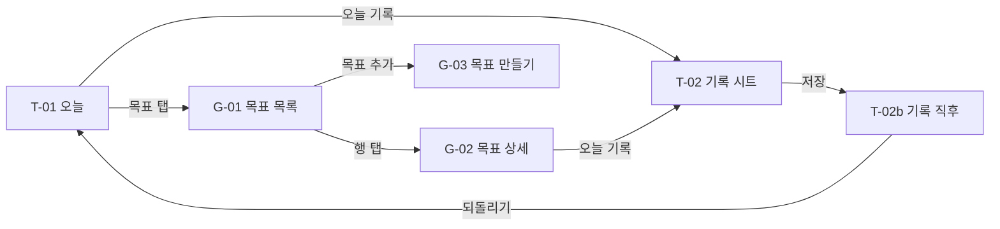
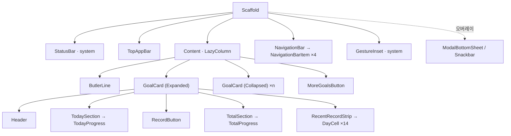

# 모바일 집사 — 2차 시안 설명서 (Android)

> 작성: hss900606 / 기준일: 2026-10-24
> [화면설계서 v0.1](../UI.md)을 다섯 가지 UX 심리학 원리로 다시 보고, [기능 정의 초안](hss900606_draft.md)·[DB 설계 초안](db_draft.md)과 맞춰 고친 2차 시안을 설명합니다.
> 확정안이 아니라 논의를 위한 초안이며, 합의된 항목은 `docs/design.md`로 옮깁니다.
>
> 화면설계서 v0.2(2026-10-24)에서 추가된 서브 화면 시안(목표 상세·만들기·보관함, 일정 추가)은 이 문서의 분석에 아직 반영하지 않았습니다.

> **Figma**: [Mobile-Butler · 2차 시안 · Android](https://www.figma.com/design/lTpDZI5Qgc55VRIsMxjmmn/Mobile-Butler?node-id=19-281)
> 1차 시안(남색 기본형)은 같은 파일 Page 1에 그대로 남아 있습니다.

## 문서 안내

| 항목      | 내용                                                                  |
|-----------|-----------------------------------------------------------------------|
| 읽는 대상 | 개발, 디자인, 기획 참여자                                             |
| 작성 범위 | 오늘 탭(T-01, T-02, T-02b), 목표 탭(G-01, G-02)                       |
| 목적      | 기능 구현을 먼저 시작할 수 있도록 화면 구조와 동작을 고정하는 것      |
| 예시 값   | 날짜(10월 20일 화요일)와 수치는 모두 예시                             |
| 화면 크기 | 412 × 917dp (Android 기준 폭), 다크 테마                              |

상태 표기는 [UI.md](../UI.md)와 같습니다.

- 반영: 시안에 들어간 내용.
- 제안: 시안을 만들며 추가·변경한 안. 합의가 필요함.
- 미정: 논의 및 결정이 필요한 사안.

> 이번 시안의 우선순위는 **"보기 좋음"보다 "개발하기 좋은 구조"** 입니다.
> 색·간격·글꼴은 모두 토큰으로 묶어 두었으므로, 기능 구현 후 UX/UI를 다듬을 때 값만 바꾸면 됩니다.

---

## 1. 한눈에 보는 변경점

1차 시안 대비 바뀐 것만 모았습니다.

| # | 1차 시안 (UI.md v0.1) | 2차 시안 | 근거 원리 | 상태 |
|---|---|---|---|---|
| 1 | 14일 기록 스트립이 화면 상단에 하나, 선택한 카드의 기록을 보여줌 | 스트립을 **펼친 카드 안으로** 옮김 | 근접성 | 제안 |
| 2 | 여러 카드가 동시에 큰 형태 | **한 번에 한 카드만 펼침**(아코디언), 나머지는 한 줄 요약 | Hick | 제안 |
| 3 | 노란색이 D-day, %, 선택 테두리, 버튼에 모두 쓰임 | **화면당 노란 채움 버튼 하나**. 기록한 칸은 채도 낮은 금색 | Von Restorff | 제안 |
| 4 | 오늘 진행 바가 '전체' 숫자 아래에 있음 | 진행 바를 **해당 숫자 바로 아래**에 둠(오늘·전체 각각) | 근접성 | 제안 |
| 5 | 기록 버튼 → 집사 대사창(화면을 어둡게 덮는 다이얼로그) | 기록 버튼 → **하단 시트**(한 번에 완료 / 양 입력) → **스낵바 + 되돌리기** | Jakob | 제안 |
| 6 | 양 입력 단계 없음 | 시트에 **−/+ 스테퍼**로 일부 기록 | (기능 정의 PARTIAL) | 제안 |
| 7 | 목표 탭 카드에도 기록 버튼 | 목표 탭은 **관리 화면**: 기록 버튼 제거, 순서 변경 손잡이 추가 | Hick | 제안 |
| 8 | 우측 상단 '+ 목표 추가', 끝까지 스크롤하면 추가(숨은 제스처) | 우측 하단 **Extended FAB** "목표 추가" 하나로 통일 | Fitts, Jakob | 제안 |
| 9 | 목표 상세 화면 없음 | **G-02 목표 상세** 추가(전체 진척, 달력 히트맵, 기록 수정·삭제) | (FUNC 요구) | 제안 |

---

## 2. 다섯 가지 원리를 어떻게 적용했나

### 2.1 Law of Proximity — 관련된 것은 붙인다

1차 시안에서 가장 크게 걸린 원리입니다.

- 기록 스트립이 카드와 떨어져 있으면 "이 칸들이 어느 목표의 기록인지"를 카드 선택 상태로 기억해야 합니다. 스트립을 카드 안으로 넣으면 그 기억이 필요 없어집니다.
- 카드 안에서도 **오늘 묶음**(오늘 할 몫 → 값 → 진행 바 → 기록 버튼)과 **전체 묶음**(전체 값 → 진행 바 → 최근 14일)을 간격으로 나눴습니다.

### 2.2 Hick's Law — 한 화면의 선택지를 줄인다

- 오늘 화면에서 사용자가 고를 일은 "어떤 목표를 기록할까" 하나입니다. 펼친 카드 1개 + 접힌 카드 + 더보기로 선택지를 단계적으로 보여줍니다.
- 기록과 관리를 탭으로 나눴습니다. 오늘 탭은 **기록**, 목표 탭은 **관리**(순서, 상세, 추가)만 합니다.

### 2.3 Von Restorff Effect — 강조는 하나만

- 노란색(primary)은 "지금 누를 버튼"에만 씁니다. 오늘 탭은 `오늘 기록`, 목표 탭은 `목표 추가`, 시트는 `남은 몫 모두 완료`입니다.
- 기록한 날 칸은 노란색 대신 채도를 낮춘 금색(`record/done`)을 써서 버튼과 경쟁하지 않게 했습니다.
- D-day와 %는 흰색/회색 글씨입니다. 선택된 카드에 노란 테두리를 두르지 않습니다(펼쳐진 것 자체가 선택 표시).

### 2.4 Fitts's Law — 자주 누르는 것은 크고 가깝게

- 모든 터치 대상은 최소 48dp입니다(버튼 높이, 아이콘 버튼, 순서 변경 손잡이).
- 기록 버튼은 카드 폭 전체를 차지합니다.
- 목표 추가는 엄지가 닿는 우측 하단에 둡니다.

### 2.5 Jakob's Law — 사용자가 이미 아는 패턴을 쓴다

- 하단 탭, 상단 앱 바, 하단 시트, 스낵바, FAB, 탭 행 모두 Material 3의 기본 패턴입니다. 다른 Android 앱에서 배운 동작이 그대로 통합니다.
- "끝까지 스크롤하면 목표 추가"처럼 발견하기 어려운 제스처는 넣지 않습니다.
- 기록 직후 화면을 막는 다이얼로그 대신, 화면을 막지 않는 스낵바로 알리고 **되돌리기**를 줍니다. 잘못 눌러도 부담이 없어야 기록 버튼을 자주 누릅니다.

---

## 3. 공통 규칙

| 항목 | 규칙 | 상태 |
|---|---|---|
| 기록 칸 표시 | 화면에는 두 가지(**한 날** / **기록 없음**)로 표시. 도메인의 FULL·PARTIAL → 한 날, NONE → 기록 없음 | 반영 |
| 빈 칸 표현 | 붉은색·경고 없이 옅은 남색. 문구도 "넘긴 날" 대신 **"기록 없음"** | 제안 |
| 오늘 칸 | 2px 흰 테두리로 위치만 표시. **기록했을 때만 채움** | 제안 |
| 미래 칸 | 달력 히트맵에서 35% 투명도로 흐리게 | 제안 |
| 펼침 규칙 | 오늘 탭에서 한 번에 한 카드만 펼침. 기본은 우선순위 1번 목표 | 제안 |
| 노란 채움 버튼 | 화면당 하나 | 제안 |
| 터치 대상 | 최소 48 × 48dp | 반영 |
| 집사 | 화면 상단 한 줄 대사(ButlerLine). 기록 직후 대사가 바뀜 | 제안 |
| 테마 | 다크 테마만 시안화. 라이트 테마는 토큰 값만 추가하면 됨 | 반영 |

---

## 4. 화면 목록

| ID | 화면 | Figma | 상태 |
|---|---|---|---|
| T-01 | 오늘 | [47:280](https://www.figma.com/design/lTpDZI5Qgc55VRIsMxjmmn/Mobile-Butler?node-id=47-280) | 제안 |
| T-02 | 오늘 · 기록 시트 | [49:393](https://www.figma.com/design/lTpDZI5Qgc55VRIsMxjmmn/Mobile-Butler?node-id=49-393) | 제안 |
| T-02b | 오늘 · 기록 직후 | [49:584](https://www.figma.com/design/lTpDZI5Qgc55VRIsMxjmmn/Mobile-Butler?node-id=49-584) | 제안 |
| G-01 | 목표 목록 | [51:680](https://www.figma.com/design/lTpDZI5Qgc55VRIsMxjmmn/Mobile-Butler?node-id=51-680) | 제안 |
| G-02 | 목표 상세 | [53:816](https://www.figma.com/design/lTpDZI5Qgc55VRIsMxjmmn/Mobile-Butler?node-id=53-816) | 제안 |
| G-03 | 목표 만들기 | 미작성 | 미정 |
| G-04 | 보관함 | 미작성 (G-01의 '보관함' 탭) | 미정 |
| S-01 | 일정 | 미작성 (시즌 1 범위 밖) | 미정 |
| ST-01 | 설정 | 미작성 | 미정 |

---

## 5. 화면별 설명

### T-01 오늘

| 영역 | 내용 |
|---|---|
| 상단 앱 바 | 제목 "오늘" + 날짜 "10월 20일 화요일" |
| 집사 한마디 | "2일 연속으로 읽고 계십니다." — 기록을 근거로 말함 |
| 펼친 카드 (먀의 투쟁) | 제목·D-26 / 오늘 할 몫 **10 / 20쪽** + 진행 바 / `오늘 기록` 버튼 / 전체 220 / 734쪽 · 30% + 진행 바 / 최근 14일(14일 중 11일 기록) |
| 접힌 카드 (금연, 주 3회 운동) | 아이콘 + 한 줄 요약 + 테두리 버튼(`피웠어요`, `+ 했어요`) |
| 더보기 | 텍스트 버튼 "목표 2개 더보기" — 누르면 나머지 접힌 카드가 이어서 나옴 |

동작

- 접힌 카드를 탭하면 그 카드가 펼쳐지고, 펼쳐져 있던 카드는 접힙니다.
- 접힌 카드의 테두리 버튼은 카드를 펼치지 않고 바로 기록 시트(T-02)를 엽니다.

### T-02 오늘 · 기록 시트

| 영역 | 내용 |
|---|---|
| 헤더 | "먀의 투쟁 · 오늘 기록" / "오늘 할 몫 20쪽 중 10쪽 읽었어요" |
| 한 번에 완료 | 노란 버튼 "남은 10쪽 모두 읽었어요" |
| 일부만 기록 | "또는 읽은 만큼만" + −/+ 스테퍼(5쪽) + 테두리 버튼 "5쪽 기록" |

동작

- 시트 바깥(어두운 영역)을 탭하거나 아래로 끌면 저장 없이 닫힙니다.
- 가장 흔한 경우(오늘 몫 완료)를 한 번의 탭으로 끝낼 수 있게 맨 위에 둡니다.
- 줄이기 목표(금연 등)는 같은 시트에서 "1개비 피웠어요" 같은 위반 기록만 받습니다. 시트 문구는 종류별로 다르게 둡니다. **(미정: 시즌 범위)**

### T-02b 오늘 · 기록 직후

| 영역 | 변화 |
|---|---|
| 집사 한마디 | "오늘 몫을 다 읽으셨습니다. 3일 연속입니다." |
| 카드 | 오늘 20 / 20쪽, 진행 바 가득 / 전체 230 / 734쪽 · 31% / 오늘 칸이 채워짐 |
| 기록 버튼 | 노란 `오늘 기록` → 테두리 `기록 수정`(연필 아이콘) |
| 스낵바 | "오늘 20쪽을 모두 기록했습니다" + `되돌리기` |

동작

- `되돌리기`는 방금 저장한 기록 한 건만 삭제합니다.
- 오늘 몫을 다 채운 카드는 노란 버튼이 사라지므로, 화면의 강조가 자연스럽게 다음 할 일로 넘어갑니다.

### G-01 목표 목록

| 영역 | 내용 |
|---|---|
| 상단 앱 바 | "목표" |
| 탭 행 | `진행 중 5` / `보관함` |
| 목록 | 두 묶음: **"오늘 화면에 펼쳐지는 목표 · 위에서 3개"** / **"더보기로 접히는 목표"** |
| 행 | 순서 변경 손잡이 · 제목 + 종류 라벨(예: "누적 · 하루") · 한 줄 요약 · 진행 바 · 오른쪽 화살표 |
| 목표 추가 | 우측 하단 Extended FAB |

예시 행

| 목표 | 종류 라벨 | 요약 |
|---|---|---|
| 먀의 투쟁 | 누적 · 하루 | 220 / 734쪽 · D-26 |
| 금연 | 줄이기 · 하루 | 21일째 · 9월 30일부터 |
| 주 3회 운동 | 빈도 · 주간 | 이번 주 1 / 3회 |
| 카페인 하루 2잔 이하 | 줄이기 · 하루 | 오늘 1 / 2잔 · 여유 1잔 |
| 체중 감량 | 도달 · 주간 | 81.2kg → 75.0kg · 이번 주 라인 81.0kg |

동작

- 손잡이를 길게 눌러 끌면 순서가 바뀝니다(FUNC-04 우선순위). 위의 3개가 오늘 탭에 펼쳐지는 대상입니다.
- 행을 탭하면 G-02 상세로 이동합니다. 이 탭에서는 기록하지 않습니다.
- 보관함 탭에는 완료(COMPLETED)와 보관(ARCHIVED) 목표가 들어갑니다. 기간이 지난 목표의 처리는 **미정**입니다(8장).

### G-02 목표 상세

| 영역 | 내용 |
|---|---|
| 상단 앱 바 | 뒤로 · 제목 "먀의 투쟁" · 더보기 메뉴(수정, 마감일 연장, 보관) |
| 요약 | **220** / 734쪽 + 진행 바 / "30% · D-26 · 11월 15일까지 · 오늘 할 몫 10 / 20쪽" / `오늘 기록` |
| 달력 히트맵 | "2026년 10월" · "20일 중 15일 기록" / 월~일 머리글 / 날짜 칸 / 범례(한 날(일부만 해도), 기록 없음) |
| 기록 이력 | 날짜·시간 · 양(+10쪽) · 연필 버튼(수정·삭제) |

동작

- 히트맵은 월 단위로 좌우 넘김. 지표는 속도("하루 평균 n쪽")가 아니라 꾸준함("n일 중 m일 기록")을 앞세웁니다.
- 같은 날 여러 건의 기록이 각각 한 줄로 보입니다(예: 10월 18일 07:55, 22:40).
- 연필 버튼은 기록 시트와 같은 형태의 수정 시트를 엽니다. 삭제는 시트 안에 둡니다.

---

## 6. 컴포넌트와 토큰

### 6.1 컴포넌트

Figma 같은 페이지 아래쪽 보드 세 곳에 있습니다.

| 보드 | 컴포넌트 | 변형 / 속성 |
|---|---|---|
| Components / Icons | 아이콘 16종 (Lucide, 24dp) | — |
| Components / Core | `DayCell` | State = Done / Empty / TodayDone / TodayEmpty |
| | `Button` | Style = Filled / Outlined / Text, Icon, Show Icon, Label |
| | `RecentRecordStrip` | Label, Count, DayCell × 14 |
| | `ButlerLine` | Message |
| | `NavigationBarItem` / `NavigationBar` | Selected = true / false |
| Components / GoalCard | `GoalCard` | State = Expanded / Collapsed, Title, Due, Today, Quota, Total, Percent, Summary |
| | `GoalListItem` | Title, Type, Summary, Show Progress |

### 6.2 토큰

모든 색·간격·모서리는 Figma 변수이며, 각 변수에 Android 코드 이름을 붙여 두었습니다. Figma Dev Mode에서 그대로 보입니다.

| 종류 | 예시 | Compose 쪽 이름 |
|---|---|---|
| 색 | background #0E1233, surfaceContainer #1C2268, primary #FFBB00, record/done #C79A2E | `MaterialTheme.colorScheme.*` |
| 간격 | space/4 · 8 · 12 · 16 · 24 | `MbSpacing.*` |
| 모서리 | radius/4 · 12 · 16 · 28 · full | `MaterialTheme.shapes.*` |
| 글꼴 | Noto Sans KR, M3 타입 스케일(displaySmall ~ labelSmall) | `MaterialTheme.typography.*` |

> `record/done`은 M3의 `tertiary` 자리에 둡니다. primary(노랑)와 따로 조절할 수 있어야 2.3절의 강조 규칙이 유지됩니다.

---

## 7. 개발을 위한 레이어 구조

### 7.1 규칙

1. **레이어 이름 = Composable 이름.** `Scaffold`, `TopAppBar`, `LazyColumn`, `NavigationBar`, `ModalBottomSheet`, `Snackbar`, `ExtendedFloatingActionButton`, `PrimaryTabRow`.
2. 이름 뒤 `· 설명`은 역할 메모입니다. 예: `Content · LazyColumn`, `EditButton · IconButton`.
3. 모든 컨테이너는 Auto Layout입니다. 세로 = `Column`, 가로 = `Row`, 간격 = `Arrangement.spacedBy`, 안쪽 여백 = `padding`.
4. 화면 위에 겹쳐 뜨는 요소(시트, 스낵바, FAB, 어두운 막)는 절대 위치로 올렸습니다. Compose에서는 `Scaffold`의 슬롯이나 `Box` 오버레이에 해당합니다.
5. `StatusBar · system`, `GestureInset · system`은 그리지 않는 영역입니다. Compose에서는 `WindowInsets`로 처리합니다.

### 7.2 오늘 화면 트리

### 7.3 코드 패키지 대응 (제안)

| 화면 | 패키지 | 주요 Composable |
|---|---|---|
| T-01, T-02, T-02b | `ui/today` | `TodayScreen`, `GoalCard`, `RecordSheet` |
| G-01, G-02, G-03, G-04 | `ui/goal` | `GoalListScreen`, `GoalDetailScreen`, `CalendarHeatmap`, `GoalEditScreen` |
| 공통 | `ui/component` | `DayCell`, `RecentRecordStrip`, `ButlerLine` |
| S-01 | `ui/schedule` | 시즌 1 범위 밖 |
| ST-01 | `ui/settings` | — |

> [DB 설계 초안](db_draft.md)의 `ui/home`, `ui/history`를 탭 이름에 맞춰 `ui/today`, `ui/goal`(상세·이력 포함)로 바꾸는 안입니다. **(제안)**

### 7.4 Figma 작업 시 주의

- 인스턴스 안쪽 요소의 크기를 직접 바꾸면 Figma가 무시합니다. 목표 목록과 상세의 진행 바는 "바가 트랙을 채우고, 트랙 오른쪽 여백으로 비율을 정하는" 구조입니다. Compose의 `LinearProgressIndicator(progress = …)`와 같은 결과입니다.
- 오늘 카드(`GoalCard`)의 진행 바는 아직 고정 너비 방식입니다. 다음 수정 때 같은 구조로 맞춥니다.

---

## 8. 다른 문서와 맞지 않는 부분

### 8.1 기능 정의 초안(hss900606_draft)과의 차이

| 항목 | UI.md v0.1 | 기능 정의 초안 | 2차 시안 처리 |
|---|---|---|---|
| 일정 탭 | 날짜별 TO-DO와 시간표 | 요일·주말 루틴 템플릿(시즌 3) | 시안화하지 않음 **(미정)** |
| 카드 탭 | 선택(스트립 전환) | 상세로 이동 | 오늘 탭은 펼침, 목표 탭은 상세 이동 **(제안)** |
| 기록 칸 상태 | 2가지(한 날/넘긴 날) | 3가지(FULL/PARTIAL/NONE) | 도메인 3가지, 화면 2가지로 표시 |
| 오늘 칸 | 안 해도 칠함 | NONE이면 회색 | 기록했을 때만 채움 **(제안)** |
| 빈 칸 문구 | "넘긴 날" | "빈 칸을 벌하지 않는다" | "기록 없음" **(제안)** |
| 더보기 | 무한 스크롤 | 접힌 요약 카드 | 접힌 카드로 이어서 표시 |
| 홈의 목표 종류 | 누적·줄이기·빈도·도달이 섞임 | 시즌 1은 누적만 | 예시로만 남김 **(미정)** |
| 집사 | 전용 아이콘·대사창, 켜기/끄기 | 시즌 1은 기본 문구 한 줄 | 한 줄 대사(ButlerLine) |
| 양 입력 | 없음 | 일부 기록(PARTIAL) 전제 | 시트에 스테퍼 |
| 순서 변경, 기록 수정·삭제 | 없음 | FUNC-04, 상세 화면 요구 | G-01 손잡이, G-02 연필 버튼 |
| 보관함 | 완료 + 기간 만료 | 실패 처리 8.1절 미정 | 완료 + 보관만. 만료는 **미정** |
| 체중 목표 | 예시에 있음 | 안전장치 필요, 시즌 미정 | 예시로만 남김 **(미정)** |

### 8.2 DB 설계 초안(db_draft)과의 구조 차이

| 항목 | 내용 |
|---|---|
| 종류별 계산 | 누적 = 합, 도달 = 마지막 값, 줄이기 = 기간별 허용량(기록 없음 = 지킨 날), 빈도 = 주간 횟수(주 시작 요일 규칙 필요). 현재 `PacingCalculator`는 합산만 지원 |
| 기록 칸 상태 | 화면의 2가지는 `DailyRecord` 3가지를 묶은 표시 규칙. "오늘" 표시는 모델에 없음(화면에서 날짜 비교) |
| 기간 만료 | `status`(ACTIVE/COMPLETED/ARCHIVED)에 없음. `dueDate`로 계산해야 함 |
| 펼친 카드 | 저장하지 않음. ViewModel 상태 |
| 시즌 1 밖 모델 | TODO, 날짜별 일정(`RoutineBlock`은 요일 템플릿이라 성격이 다름), 집사 켜기/끄기(DataStore, 시즌 2) |
| 같은 날 여러 기록 | `progress_entries`가 여러 행을 허용하므로 G-02 이력에 각각 표시 — 일치 |

---

## 9. 미정 사항

| # | 질문 | 시안의 임시 처리 |
|---|---|---|
| 1 | 아무것도 기록하지 않은 오늘 칸을 칠할 것인가 | 칠하지 않고 테두리만 |
| 2 | 누적이 아닌 목표(줄이기·빈도·도달)를 시즌 1 화면에 둘 것인가 | 예시로만 표시, 기록 시트는 누적만 시안화 |
| 3 | 일정 탭은 날짜별 TO-DO인가, 요일 루틴 템플릿인가 | 시안화하지 않음 |
| 4 | 오늘 탭에서 카드 탭 = 펼침인가, 상세 이동인가 | 펼침 |
| 5 | 기간이 지난 목표는 어디로 가는가(기능 정의 8.1절) | 결정 전까지 진행 중 목록에 남김 |
| 6 | 줄이기 목표의 기록 칸은 "지킨 날"을 칠할 것인가 | 결정 필요(기록 없음 = 지킨 날이 되어 의미가 반대) |

---

## 10. 다음 작업

1. 9장 미정 사항 1·2·4를 정하고 [요구사항 · 기능 명세서](../requirement_analysis.md)에 반영.
2. G-03 목표 만들기, G-04 보관함 시안 작성.
3. `GoalCard` 진행 바를 7.4의 구조로 통일.
4. 기능 구현 후, 실제 데이터로 화면을 다시 캡처해 간격·대비·문구를 다듬기.
